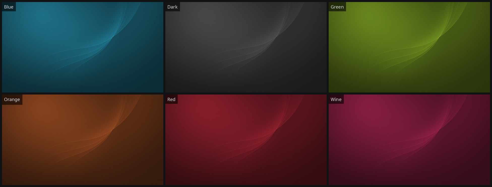
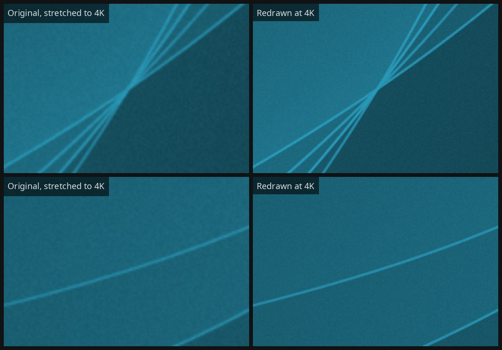
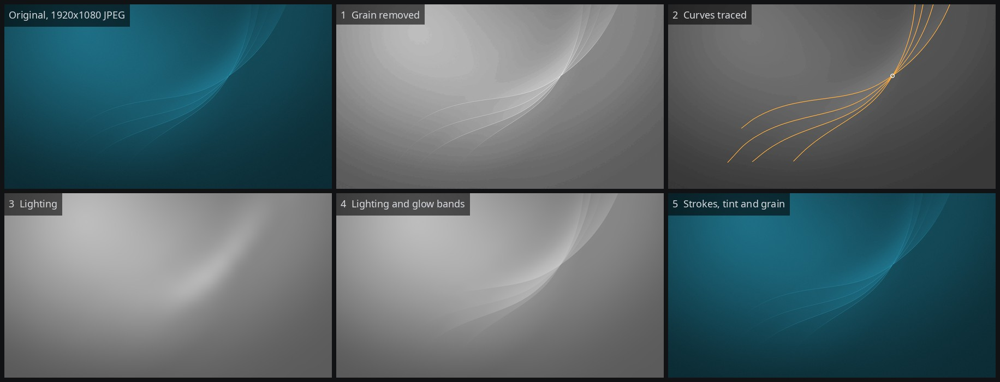
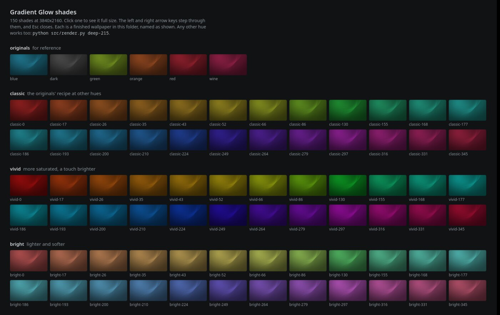
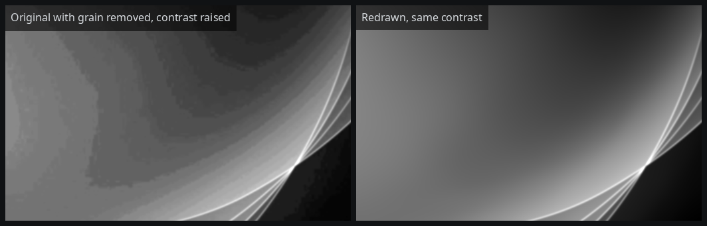

# Gradient Glow
Renders [Gradient Glow](https://store.kde.org/p/1239429), six 1920x1080 wallpapers by antechdesigns, at any size.

The design is antechdesigns' work, published on the KDE Store. This project fits a model of it and renders sharper copies and new shades.



## Goal

The originals are 1920x1080 only. A 4K screen stretches them to twice their size, with soft strokes and coarse grain.

Goals for a render:

- Same design and colours as the original
- Sharp strokes and edges at the output size
- Smooth gradients (the originals have 8-bit banding under the grain)
- New shades of the same design

Blue original stretched to 4K (left) and rendered at 4K (right), both at 2x:



## Sources

[Gradient Glow 6 Colors to Choose From](https://store.kde.org/p/1239429) by antechdesigns, on the KDE Store since 2018-06-06. The store page states no licence.

`fit.py` and `compare.py` read its six files from `originals/`, named `Gradient Glow {Colour}.jpg`:

| Colours                        | Saved from              | Saved on   |
|--------------------------------|-------------------------|------------|
| Blue, Green, Orange, Red, Wine | Adobe Photoshop CC 2017 | 2018-06-06 |
| Dark                           | GIMP 2.10.6             | 2018-09-12 |

Each is a JPEG at about quality 99 with 4:4:4 chroma.

`.gitignore` keeps `originals/` out of the repository. Three README images show Blue, whole or in part.

## Process

`fit.py` fits a model of the design from the originals, in five steps:

1. Remove the grain (it is the same in R, G, and B).
2. Trace the four curves and fit a spline to each.
3. Fit the lighting as a smooth surface on a lattice of about 80 px.
4. Fit a glow band on each side of every curve, lighter inside and darker outside.
5. Fit stroke opacity along each curve, then a tint and a grain strength per colour.



Steps 1 to 4 and the stroke fit use Blue only. All six originals are one brightness field under different tints.

`render.py` renders the model. It evaluates lighting, glow bands, and strokes at each output pixel, applies the tint, and adds grain.

## Screenshots

Gallery page written by `shades.py`:



Blue with grain removed and contrast raised, original (left) and render (right):



## Quickstart

```bash
python src/render.py                              # All six original colours at 3840x2160, into the current folder
python src/render.py wine deep-215 -s 5k          # One original colour and one new shade at 5120x2880
python src/shades.py                              # 24 hues of every style into shades/, with a gallery page
python src/compare.py                             # Measure every colour against its original
black src/ extras/ && flake8 src/ extras/         # Format and lint before committing
```

These commands need the virtual environment from the Setup section. `compare.py` also needs the originals.

## Where to start

- Repository layout, tech stack, setup, and commands: [General info](#general-info)
- Model parts, shades, and accuracy: [Project-specific info](#project-specific-info)
- Code map, conventions, and code style: [AGENTS.md](AGENTS.md)

## General info
<details>
<summary><b>Repository layout</b></summary>

```
wallpaper/
|-- README.md               # Overview, setup, commands, model parts
|-- AGENTS.md               # Code map, conventions, project context
|-- requirements.txt        # One dependency set, lint tools included
|-- tox.ini                 # flake8 config (E501 and E203 ignored)
|-- .gitignore              # Ignore originals/, shades/, compare/, and rendered PNGs
|-- originals/              # The six JPEGs from the KDE Store, not committed
|-- docs/
|   `-- img/                # README images
|-- extras/
|   `-- plasma/             # Optional helper applying images to KDE Plasma activities
|-- .claude/
|   `-- skills/
|       `-- style-review/   # Review skill and its prose rules
|
`-- src/
    |-- render.py           # Render wallpapers at any size
    |-- shades.py           # Render every style at 24 hues, plus the gallery page
    |-- fit.py              # Fit the model from the original JPEGs
    |-- compare.py          # Measure renders against the originals
    |
    |-- config.py           # Paths and tuning constants
    |-- cli.py              # Size parsing and logging setup
    |-- field.py            # Brightness field: lighting, glow bands, strokes
    |-- curves.py           # Curve polylines and closest-point projection
    |-- splines.py          # Cubic B-spline helpers
    |-- palettes.py         # Palette lookup, shade tints, grain
    |-- originals.py        # Original JPEG loading and grain measurement
    |-- fitting/            # Fit stages: grain, trace, distances, smooth, strokes
    |-- data/               # gradient-glow.json, the fitted model
    |-- templates/          # gallery.html
    `-- static/             # gallery.css, gallery.js
```

`fit.py` writes `src/data/gradient-glow.json` and the other three commands read it. `extras/plasma/` imports nothing from `src/`.

</details>

<details>
<summary><b>Tech stack</b></summary>

| Layer          | Technology                                              |
|----------------|---------------------------------------------------------|
| Language       | Python 3.14                                             |
| Numerics       | NumPy and SciPy                                         |
| Images         | Pillow                                                  |
| Gallery page   | Static HTML, CSS, and vanilla JS                        |
| Plasma helper  | KDE Plasma 6 desktop scripting through `qdbus-qt6`      |
| Format, lint   | `black` and `flake8`                                    |

</details>

<details>
<summary><b>Prerequisites</b></summary>

- Python 3.14
- For `fit.py` and `compare.py`: the six originals from the [KDE Store page](https://store.kde.org/p/1239429), in `originals/`
- For the Plasma helper: KDE Plasma 6 with `qdbus-qt6` on `$PATH`

</details>

<details>
<summary><b>Setup</b></summary>

Create the virtual environment and install the dependencies:

```bash
python3 -m venv .venv
source .venv/bin/activate
pip install -r requirements.txt
```

</details>

<details>
<summary><b>Commands</b></summary>

Run every command from the repository root. Each one takes `--help`.

### Render wallpapers

`render.py` renders wallpapers from the model file.

```bash
python src/render.py                           # All six original colours at 3840x2160
python src/render.py wine dark -s 5k           # Two colours at 5120x2880
python src/render.py classic-270 -s 3440x1440  # A new shade, cropped to an ultrawide frame
python src/render.py --grain 0.5               # Half the grain, 0 turns it off
```

| Flag           | Default                                   | Effect |
|----------------|-------------------------------------------|--------|
| `-s`, `--size` | `4k`                                      | `1080p`, `1440p`, `4k`, `5k`, `8k`, or `{WIDTH}x{HEIGHT}`. Other aspect ratios crop. |
| `-d`, `--outdir` | current folder                          | Folder to write into. |
| `-n`, `--name` | `gradient-glow-{colour}-{width}x{height}.png` | File name pattern. `{Colour}` gives the capitalised name. |
| `--grain`      | `1`                                       | Grain strength. `1` matches the originals. |
| `--grain-size` | `1`                                       | Grain cell size in output pixels. At 4K, `2` gives the grain of a stretched original. |
| `--seed`       | `0`                                       | Grain random seed. |

### Render a range of shades

`shades.py` renders the six original colours and every style at 24 hues into `shades/`. `shades/index.html`, the gallery page, lists them and opens each full size.

```bash
python src/shades.py
xdg-open shades/index.html
```

150 wallpapers at 4K take about a minute and 1.2 GB. `shades/index.html#deep-224` opens that shade.

### Refit the model

`fit.py` fits the model from the original JPEGs and rewrites `src/data/gradient-glow.json`. It takes about three minutes.

```bash
python src/fit.py                 # Full fit
python src/fit.py --keep-shape    # Tint and grain only, after adding another colour's JPEG
```

### Measure renders against the originals

`compare.py` renders every colour at 1920x1080, logs PSNR and colour error against its original, and writes side-by-side 4K crops to `compare/`.

```bash
python src/compare.py
```

</details>

<details>
<summary><b>Apply to KDE Plasma (optional)</b></summary>

`extras/plasma/apply.py` sets an image on every screen of a Plasma activity. Each activity can take a different image.

Render, then apply:

```bash
python src/render.py deep-200 wine -d ~/Pictures/wallpapers
python extras/plasma/apply.py \
    Default=~/Pictures/wallpapers/gradient-glow-deep-200-3840x2160.png \
    Work=~/Pictures/wallpapers/gradient-glow-wine-3840x2160.png
```

On other desktops, set a file from `render.py` as the wallpaper through the desktop's settings.

</details>

<details>
<summary><b>Format and lint</b></summary>

Format, then lint:

```bash
black src/ extras/
flake8 src/ extras/
```

`tox.ini` ignores `E501` (line length) and `E203` (slice spacing from `black`).

</details>

## Project-specific info
<details>
<summary><b>Model parts</b></summary>

| Part       | Contents |
|------------|----------|
| Brightness | One field shared by all six colours. A palette converts it to RGB as `brightness * tint + offset`. |
| Lighting   | Glow at top left, vignette toward the edges |
| Curves     | Four, crossing at (1315, 418) |
| Glow bands | Lighter inside each curve, darker outside, hard edge on the curve |
| Strokes    | 1.35 px wide at 1920x1080, one colour, near-opaque mid-curve, fading at both ends. Where strokes cross, the most opaque one sets the opacity. |
| Grain      | Monochrome, about +-3.5 of 255 levels (+-3 on Dark), one cell per output pixel |

`render.py` anti-aliases edges and strokes at the output pixel size.

</details>

<details>
<summary><b>Colours and shades</b></summary>

The five coloured originals share HSV saturation 0.78 and brightness 1.20, at five hues:

| Original | Hue |
|----------|-----|
| Blue     | 193 |
| Green    | 76  |
| Orange   | 21  |
| Red      | 353 |
| Wine     | 340 |

Dark is grey at brightness 0.66.

Name a new shade `{style}-{hue}`, with a hue of 0 to 359:

| Style     | Look |
|-----------|------|
| `classic` | The originals' recipe at any hue |
| `vivid`   | More saturated, a touch brighter |
| `bright`  | Lighter and softer |
| `muted`   | Dusty, about half the saturation |
| `deep`    | Darker and richer |
| `ash`     | Near-greys with a hint of colour |

`shades.py` spaces its 24 hues evenly in [OKLab](https://bottosson.github.io/posts/oklab/) hue. Even HSV steps give six near-identical greens.

</details>

<details>
<summary><b>Differences from the originals</b></summary>

- Smooth gradients. The originals were rounded to 8 bits before the grain went on.
- No JPEG noise around the strokes.
- Finer grain, one cell per output pixel. An original stretched to 4K has 2x2 pixel cells.

</details>

<details>
<summary><b>How close the renders are</b></summary>

`compare.py` figures at 1920x1080:

| Colour | PSNR without grain | Ceiling from the original's grain | PSNR, both blurred 2 px | Mean colour error, levels | Grain std, original / render |
|--------|--------------------|-----------------------------------|-------------------------|---------------------------|------------------------------|
| Blue   | 41.02 dB | 41.03 dB | 52.9 dB | 0.10 | 2.22 / 2.22 |
| Dark   | 41.87 dB | 41.88 dB | 55.3 dB | 0.01 | 1.99 / 1.98 |
| Green  | 40.97 dB | 40.99 dB | 52.6 dB | 0.09 | 2.22 / 2.23 |
| Orange | 40.89 dB | 40.90 dB | 52.1 dB | 0.06 | 2.25 / 2.26 |
| Red    | 40.99 dB | 41.00 dB | 52.9 dB | 0.03 | 2.22 / 2.23 |
| Wine   | 41.07 dB | 41.08 dB | 53.8 dB | 0.07 | 2.23 / 2.24 |

The grain is random and matches in strength only.

</details>
